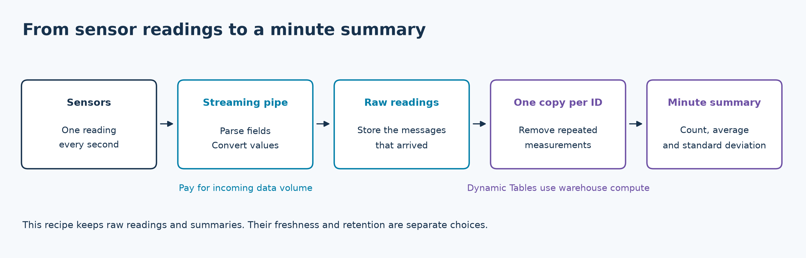
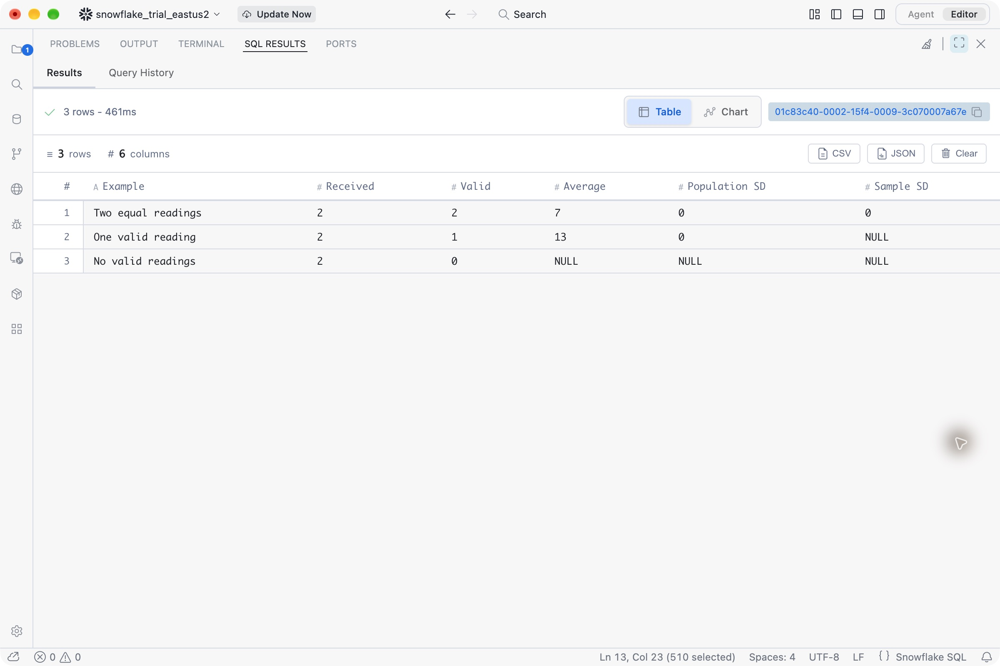
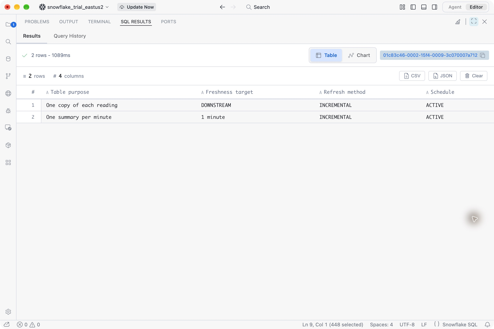
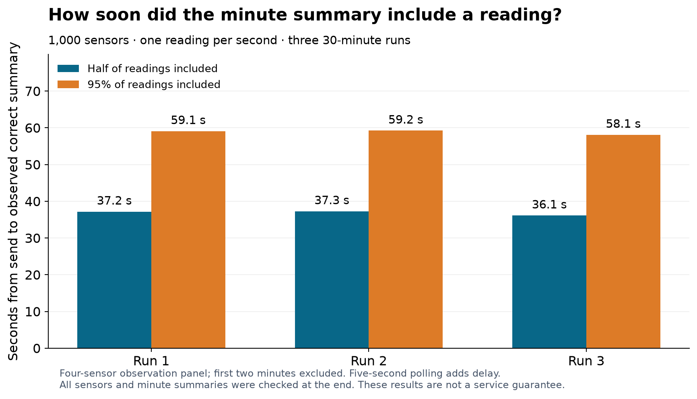
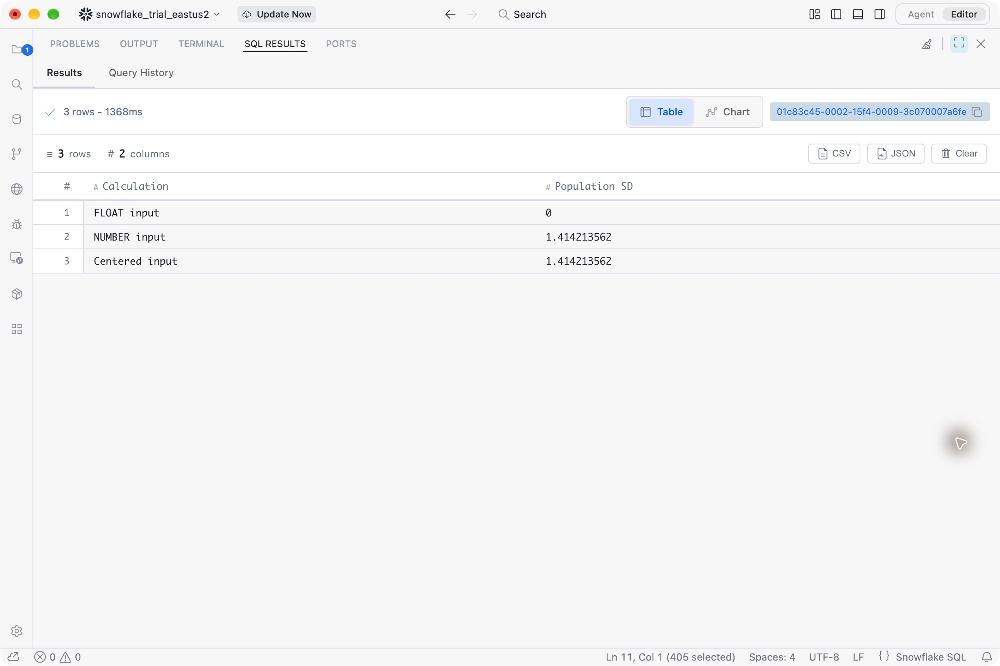

# Sensor data in Snowflake: where should the average live?

*A practical guide to streaming pipes, minute summaries, moving windows and the cost of keeping them fresh.*

A sensor sends one reading every second. You want its average and standard deviation—the amount those readings vary around the average. Can Snowflake calculate them as the data arrives? And should you store every reading, or just the result?

**Yes, Snowflake can maintain those statistics. Where the calculation runs depends on the ingestion path and the freshness you need.**

The streaming pipe tested here can reshape individual messages. Its aggregate definitions were rejected in my trial account. However, Snowflake also describes **Streaming Transformations in private preview**, including aggregation in a SQL pipe before data reaches a table. “Pipes can never aggregate” would therefore be the wrong conclusion.

The preview was unavailable in the trial: a pipe using the announcement's join pattern was rejected, and the time-window probe reported disabled feature gates. This limits what I could test, not what the preview can do. Its exact standard-deviation functions, window boundaries and late-data rules still need validation with preview access. [Snowflake's real-time analytics overview](https://www.snowflake.com/en/blog/real-time-analytics-snowflake/).

For a reproducible path in the trial, I used Snowpipe Streaming to store readings, then Dynamic Tables to maintain their summaries. A Dynamic Table is a saved SQL result that Snowflake keeps updated.

The complete example, experiments and screenshots are in [the companion repository](https://github.com/MiguelElGallo/snowflake-timeseries).

## Decide what “every second” means

Three choices are easy to confuse:

- **Measurement frequency:** a device takes a reading every second.
- **Calculation window:** combine one minute, ten minutes or an hour of readings.
- **Freshness:** how long the application can wait to see the updated answer.

A sensor can measure every second while a dashboard shows a minute summary updated less frequently. Conversely, an application might need the last minute's average available almost immediately after each reading.

Also separate **fresh data** from **fast queries**. A query can return in milliseconds while reading an older summary. Making that query faster does not make the summary newer.

Here is the first design I would try for a dashboard that can tolerate roughly minute-level freshness:



*This recipe separates receiving messages, removing repeated measurements and calculating the statistics people read.*

Creating the summary does **not** stop Snowflake from storing the raw readings. These are separate tables. If you send one row per second to the raw table, that is what it stores.

## Build a complete minute summary

The [quickstart](https://github.com/MiguelElGallo/snowflake-timeseries/tree/main/quickstart) creates an isolated database and an X-Small warehouse. A warehouse is the compute that runs SQL and refreshes the summaries. It uses your existing Snowflake key-pair connection; no credentials belong in the example code.

You need Python 3.12, an existing compatible Snowflake key-pair connection, access to high-performance streaming with Elastic Channels, and permission to create a database and warehouse. The X-Small warehouse consumes credits while running. Check the [full prerequisites](https://github.com/MiguelElGallo/snowflake-timeseries/blob/main/quickstart/README.md#prerequisites), including the supported key-file format, before running:

```bash
git clone https://github.com/MiguelElGallo/snowflake-timeseries.git
cd snowflake-timeseries
python3.12 -m venv .venv
source .venv/bin/activate
python -m pip install -r quickstart/requirements.txt
export SNOWFLAKE_CONNECTION_NAME=your_existing_keypair_connection
python quickstart/demo.py setup
python quickstart/demo.py seed
python quickstart/demo.py read
```

`setup` creates the objects. `seed` sends six messages and waits up to four minutes for the automatically updated summary. Success starts with **PASS: duplicate excluded, invalid value retained as NULL**, followed by five distinct measurements, four valid values, average **25**, population SD about **11.18** and sample SD about **12.91**. `read` prints the summary. Creating a pipe alone does not send data; the [producer and setup runner](https://github.com/MiguelElGallo/snowflake-timeseries/blob/main/quickstart/demo.py) contains the complete executable code.

You now have a working result. The raw table, pipe and two Dynamic Tables explained next are already created by `setup`; you do not need to run those `CREATE` statements again. When you finish exploring, remove the example with `python quickstart/demo.py cleanup`.

A message looks like this:

```json
{
  "event_id": "reading-1042",
  "sensor_id": "pump-7",
  "event_ts": "2000-01-01T12:00:01.000000",
  "value": "23.125",
  "sent_at": "2000-01-01T12:00:01.050000"
}
```

The timestamp is illustrative; the producer generates its own times. `event_ts` is when the measurement happened, while `sent_at` records when this copy was sent. Both represent UTC throughout this example.

The destination stores the converted value and its original text:

```sql
CREATE TABLE sensor_raw (
  event_id VARCHAR NOT NULL,
  sensor_id VARCHAR NOT NULL,
  event_ts TIMESTAMP_NTZ(6) NOT NULL,
  value NUMBER(38,6),
  source_value VARCHAR,
  sent_at TIMESTAMP_NTZ(6) NOT NULL
) ROW_TIMESTAMP=TRUE CHANGE_TRACKING=TRUE;

CREATE PIPE sensor_pipe AS COPY INTO sensor_raw FROM (
  SELECT $1:event_id::VARCHAR,
         $1:sensor_id::VARCHAR,
         TO_TIMESTAMP_NTZ($1:event_ts::VARCHAR),
         TRY_TO_DECIMAL($1:value::VARCHAR, 38, 6),
         $1:value::VARCHAR,
         TO_TIMESTAMP_NTZ($1:sent_at::VARCHAR)
  FROM TABLE(DATA_SOURCE(TYPE=>'STREAMING'))
);
```

Each expression works on one message. A malformed numeric value becomes `NULL`, and the original text remains available for investigation. This is not a general error-handling policy: malformed timestamps or missing required fields can still fail ingestion. Snowflake documents the available [streaming pipe transformations](https://docs.snowflake.com/en/user-guide/snowpipe-streaming/snowpipe-streaming-pipe-object) and [COPY transformation limits](https://docs.snowflake.com/en/user-guide/data-load-transform).

`NUMBER(38,6)` keeps six decimal places. Choose the scale for your sensor's range and resolution; this choice is not universal.

### Count measurements, not retransmissions

Suppose the values are 10, 20 and 30. Their average is 20. If the application sends the first measurement again as another input row, the uncorrected average becomes 17.5.

Transport delivery guarantees and measurement identity solve different problems. A producer can deliberately submit the same measurement in a new request. Give each measurement a stable ID if that should count only once. Two equal readings with **different** IDs still count as two measurements.

This table keeps one copy per sensor and measurement ID:

```sql
CREATE DYNAMIC TABLE sensor_readings_deduplicated
  TARGET_LAG=DOWNSTREAM
  WAREHOUSE=SENSOR_TIMESERIES_DEMO_WH
  REFRESH_MODE=INCREMENTAL
  INITIALIZE=ON_CREATE
AS
SELECT event_id, sensor_id, event_ts, value, source_value, sent_at
FROM sensor_raw
QUALIFY ROW_NUMBER() OVER (
  PARTITION BY sensor_id, event_id ORDER BY sent_at DESC
)=1;
```

`DOWNSTREAM` lets the consuming summary drive refreshes. `INCREMENTAL` asks Snowflake to maintain changes rather than recalculate everything; unsupported definitions fail instead of silently choosing a different mode. The example assumes a measurement's value and event time never change. Correcting a measurement requires an explicit versioning rule. [Supported Dynamic Table queries](https://docs.snowflake.com/en/user-guide/dynamic-tables/supported-queries).

Now the actual statistics:

```sql
CREATE DYNAMIC TABLE sensor_minute
  TARGET_LAG='60 seconds'
  WAREHOUSE=SENSOR_TIMESERIES_DEMO_WH
  REFRESH_MODE=INCREMENTAL
  INITIALIZE=ON_CREATE
AS
SELECT sensor_id,
       DATE_TRUNC('MINUTE', event_ts) AS minute_start,
       COUNT(*) AS received_readings,
       COUNT(value) AS valid_readings,
       AVG(value) AS average,
       STDDEV_POP(value) AS population_sd,
       STDDEV_SAMP(value) AS sample_sd
FROM sensor_readings_deduplicated
GROUP BY sensor_id, minute_start;

SELECT * FROM sensor_minute ORDER BY minute_start, sensor_id;
```

This produces one row per sensor per clock minute. A reading at 12:00:59 belongs to the 12:00 bucket; a reading at 12:01:00 belongs to the next one. A late reading can revise its earlier bucket after refresh.

Keep the count beside the average. An average based on one valid reading tells a different story from an average based on sixty.

`STDDEV_POP` describes variation among the valid readings in this window. `STDDEV_SAMP` estimates variation in a larger population from a sample. For one valid value, the first is zero and the second is `NULL`. With no valid values, the average and both deviations are `NULL`; that does not mean “a steady sensor.” [Snowflake's standard-deviation definitions](https://docs.snowflake.com/en/sql-reference/functions/stddev).



*A real SQL result: equal readings, a single valid reading and no valid readings produce different answers.*

The 60-second target is a freshness objective, not a fixed timer or a hard maximum. Snowflake schedules refreshes around the dependency graph and the work required. Its documented minimum target is one minute. [How target lag works](https://docs.snowflake.com/en/user-guide/dynamic-tables/target-lag).



*The deduplicated readings follow their consumer's refresh needs; the minute summary has a one-minute target.*

## How long the summary took to update

I ran 1,000 synthetic sensors at one reading per second for three 30-minute runs. All 5.4 million readings and their final minute summaries passed the independent count and statistics checks. A separate accelerated burst of 120,000 readings also passed. The large-offset precision problem described below was a separate diagnostic.

After excluding the first two minutes of each run, half of the sampled readings appeared in a correct summary within **about 36–37 seconds**; 95% appeared within **about 58–59 seconds**. The longest observed delay was about **67 seconds**.



*The bars show when half and 95% of sampled readings had appeared in a correct minute summary.*

These timings include five-second polling and query delay. Four sensors were observed during ingestion; every sensor and minute bucket was checked at the end. No sampled reading remained unobserved. This demonstrates the tested configuration's behavior, not a production deadline or a rolling-window capacity result. The [measurements and method](https://github.com/MiguelElGallo/snowflake-timeseries/blob/main/docs/results.md#sustained-workload) are available to inspect and reproduce.

## “This minute” and “the last minute” are different

At 12:01:30, the current clock-minute bucket contains readings since 12:01:00. The last 60 seconds also includes readings from the second half of the previous minute.

For the latter, use a time filter and group by sensor. This is an **optional extension**, separate from the tables created by `setup`:

```sql
CREATE DYNAMIC TABLE sensor_last_minute
  TARGET_LAG='60 seconds'
  WAREHOUSE=SENSOR_TIMESERIES_DEMO_WH
  REFRESH_MODE=INCREMENTAL
  INITIALIZE=ON_CREATE
AS
SELECT sensor_id,
       COUNT(*) AS received_readings,
       COUNT(value) AS valid_readings,
       AVG(value) AS average,
       STDDEV_POP(value) AS population_sd,
       STDDEV_SAMP(value) AS sample_sd
FROM sensor_readings_deduplicated
WHERE event_ts > DATEADD('SECOND', -60,
        CONVERT_TIMEZONE('UTC', CURRENT_TIMESTAMP())::TIMESTAMP_NTZ)
  AND event_ts <= CONVERT_TIMEZONE('UTC', CURRENT_TIMESTAMP())::TIMESTAMP_NTZ
GROUP BY sensor_id;
```

This includes readings newer than 60 seconds ago and no later than now. The explicit UTC conversion matches the convention used for the stored timestamps. Simply removing timezone information from a session-local clock can shift the window. [Timestamp types](https://docs.snowflake.com/en/sql-reference/data-types-datetime), [timezone conversion](https://docs.snowflake.com/en/sql-reference/functions/convert_timezone).

While the demo resources still exist, create it with `python quickstart/demo.py moving-window`. The seed example uses a completed minute, so it normally produces no row in this current window. The [moving-window guide](https://github.com/MiguelElGallo/snowflake-timeseries/blob/main/docs/how-to-explore.md) explains how to continue after cleanup; the larger experiment supplies fresh readings to exercise it.

Silence matters too. When a sensor stops, its last reading must eventually leave the window. In the idle experiment, the summary disappeared about 103 seconds after the reading's event time, with no new input or manual refresh. That was roughly 43 seconds after the logical expiry, observed by polling. It demonstrates automatic expiry in that configuration, not an exact expiry timer.

For a historical rolling answer beside every reading, use a SQL window ordered by event time. The [complete experiment](https://github.com/MiguelElGallo/snowflake-timeseries/tree/main/experiments/dynamic-tables) includes `RANGE BETWEEN INTERVAL '60 seconds' PRECEDING AND CURRENT ROW`. That includes the reading exactly 60 seconds earlier. `ROWS` counts records instead of elapsed time, which gives different answers when readings are missing or duplicated. [Window frame syntax](https://docs.snowflake.com/en/sql-reference/functions-window-syntax).

The companion [gap and calibration example](https://github.com/MiguelElGallo/snowflake-timeseries/blob/main/docs/irregular-readings.md) shows how to fill a chart's missing timestamps and apply the calibration valid when each measurement occurred. It uses `RESAMPLE` and interpolation (Open Preview), plus `ASOF JOIN`. Keep estimated values visibly separate from measurements: an apparently complete chart can otherwise conceal missing readings. [Snowflake's time-series guide](https://docs.snowflake.com/en/user-guide/querying-time-series-data).

## A numerical surprise worth checking

The five values `1,000,000,000,000 + [-2, -1, 0, 1, 2]` have a population SD of about 1.4142. In the FLOAT experiment, Snowflake returned zero, both in an ordinary query and a Dynamic Table. The input values were still distinct; the loss occurred in the aggregate calculation.

```sql
WITH readings AS (
  SELECT (1000000000000 + column1)::FLOAT AS value
  FROM VALUES (-2), (-1), (0), (1), (2)
)
SELECT STDDEV_POP(value) AS float_sd,
       STDDEV_POP(value::NUMBER(38,6)) AS fixed_point_sd,
       STDDEV_POP(value - 1000000000000) AS centered_sd
FROM readings;
```

Both alternatives recovered the expected answer for this example. Subtracting a fixed reference changes the average but leaves the standard deviation unchanged. A suitable fixed-point type can also help; converting later cannot recover detail already lost when the original value was stored. Snowflake documents [rounding errors in floating-point calculations](https://docs.snowflake.com/en/sql-reference/data-types-numeric#rounding-errors).



*The same five readings: the FLOAT aggregate returned zero; the fixed-point and centered calculations returned about 1.4142.*

## What should you keep?

For 1,000 sensors reporting every second, raw ingestion means 86.4 million readings a day. One summary per sensor per minute means 1.44 million summary rows a day. Those row counts do not translate directly into storage bytes: summaries have more columns, and compression differs.

There are four useful choices:

| Storage choice | What you gain | What you give up |
|---|---|---|
| Raw readings only | Full detail and freedom to ask new questions | Repeated calculation when queried |
| Raw readings plus summaries | Detail for investigation and convenient reporting | Additional refresh work and stored results |
| Summaries only | Less incoming detail and smaller history | Individual spikes, exact order and later recalculation |
| Recent raw plus retained summaries | Detailed troubleshooting for recent events and longer history | A policy for closing and correcting old summaries |

An ordinary Dynamic Table follows its source. Deleting old raw readings can remove their summaries too. It is not automatically an archive. Use a separate retained summary table or an explicitly designed frozen-history policy before deleting the only source. The repository's [retention guidance](https://github.com/MiguelElGallo/snowflake-timeseries/blob/main/docs/alternatives.md) explains the choices. [Dynamic Table design patterns](https://docs.snowflake.com/en/user-guide/dynamic-tables/design-patterns).

If a device or upstream processor sends only summaries, store the valid count with each mean. An hour's mean should weight minutes by their counts. Do not average standard deviations to obtain an hour's deviation; the [merge example](https://github.com/MiguelElGallo/snowflake-timeseries/blob/main/examples/merge_summaries.py) carries the extra information needed to combine them correctly.

## Where the other options fit

| Option | A useful reason to choose it |
|---|---|
| Ordinary SQL query or view | You need the statistics occasionally and can calculate them when asked. |
| Dynamic Tables | You want SQL-defined summaries maintained for dashboards and analysis. |
| Streams and tasks | You need explicit update rules, correction handling or retained summaries written on a schedule or trigger. |
| Materialized view | An eligible, repeated aggregation over one physical table fits its restrictions. |
| Private-preview Streaming Transformations | You have preview access and want to evaluate processing before rows land. Validate the exact functions and window semantics. |
| Interactive warehouses | Many users or applications need fast SQL queries over existing raw or summary tables. |
| Online Feature Store | An application needs current per-sensor feature values through a lookup API, including supported streaming calculations. |

Tasks give you control over what is written, but you also own the correctness of updates and retries. Materialized views support eligible aggregates, including average and standard deviation, but their restricted query shape and Enterprise Edition requirement matter. They are not a general replacement for the deduplication-plus-summary chain above. [Triggered tasks](https://docs.snowflake.com/en/user-guide/tasks-triggered), [materialized-view capabilities and restrictions](https://docs.snowflake.com/en/user-guide/views-materialized).

**Interactive Analytics and the Online Feature Store are different choices.** Interactive warehouses can query standard, Dynamic and Iceberg tables directly. That can avoid copying a summary into a separate serving table. It improves the query-serving step; it does not replace the work of maintaining the summary. Long queries can fall back to a standard warehouse. [Interactive Analytics documentation](https://docs.snowflake.com/en/user-guide/interactive).

A separate live check read all ten expected summary rows through an Interactive warehouse, including late-arrival corrections and NULL values, without making a second data copy. It verified that serving path, not its speed or concurrency. The [reproducer](https://github.com/MiguelElGallo/snowflake-timeseries/tree/main/experiments/interactive) includes the checks.

The Online Feature Store has its own ingestion and lookup APIs. With direct streaming ingestion, it can maintain supported time-window calculations as readings arrive; synchronizing previously calculated offline features is a different route. It is not extra SQL placed in the Snowpipe used above. The `Feature.stddev` API is documented as population standard deviation; match that definition before comparing results. [Online Feature Store](https://docs.snowflake.com/en/developer-guide/snowflake-ml/feature-store/online-feature-store), [advanced feature engineering](https://docs.snowflake.com/en/developer-guide/snowflake-ml/feature-store/advanced-feature-engineering), [official API source](https://github.com/snowflakedb/snowflake-ml-python/blob/main/snowflake/ml/feature_store/feature.py).

I could not benchmark its live behavior: the trial account rejected the compute family required to provision the service. The repository includes the prepared tests and local checks, clearly marked as **not verified against a running online service**. That is an account limitation, not a failed statistics result.

## What do the alternatives cost?

Start with four separate costs: ingestion, calculation, serving queries and retained data. A cheap ingestion rate does not describe the whole application.

For 1,000 sensors at one reading per second, assume **100 billable bytes per reading**. That is 259.2 decimal GB over 30 days. At 0.0037 credits per GB for high-performance Snowpipe Streaming, ingestion is about **0.96 credits per month**. At an illustrative $3 per credit, that is **$2.88**. Replace both assumptions with your measured billable volume and contract price. This rate is not an established price for private-preview Streaming Transformations. [Streaming billing](https://docs.snowflake.com/en/user-guide/snowpipe-streaming/snowpipe-streaming-high-performance-cost), [Snowflake's consumption table](https://www.snowflake.com/legal-files/CreditConsumptionTable.pdf).

Compute can be the larger part:

| Component | Published credit rate | Illustration: running for 720 hours |
|---|---:|---:|
| Azure Gen2 standard X-Small warehouse | 1.25/hour | 900 credits; $2,700 at $3/credit |
| Interactive X-Small warehouse, one cluster | 0.60/hour | 432 credits; $1,296 at $3/credit |
| Online Feature Store XS baseline | 0.76/hour | 547.2 credits; about $1,642 at $3/credit |
| Online Feature Store S baseline | 2.66/hour | 1,915.2 credits; about $5,746 at $3/credit |

These are **uptime budgets, not equal-capacity benchmarks or complete bills**. The trial's standard warehouse used Azure Gen2. The appropriate warehouse, service size and active hours depend on your workload. Rates come from the [consumption table](https://www.snowflake.com/legal-files/CreditConsumptionTable.pdf).

Standard serverless tasks and materialized-view maintenance are priced by the computing resources consumed: respectively 0.9 and 2 credits for work equivalent to an X-Small warehouse running for an hour, before applicable cloud-services charges. A job's elapsed time alone does not tell you that amount. The [cost worksheet](https://github.com/MiguelElGallo/snowflake-timeseries/blob/main/docs/costs.md#serverless-task-and-materialized-view-examples) includes explicit examples.

Here are five separate usage examples for a 30-day month, all assuming $3 per credit. Each row covers only the named charge; the workloads do not promise equivalent results or freshness.

| Component | Explicit usage assumption | Illustrative monthly charge |
|---|---|---:|
| Raw streaming ingestion | 1,000 sensors, one reading/second, 100 billable bytes/reading | $2.88 |
| Summary streaming ingestion | 1,000 sensors, one summary/minute, 200 billable bytes/summary | $0.10 |
| Occasional SQL on Azure Gen2 XS | 12 billable warehouse minutes/day | $22.50 |
| Serverless task compute | One task/minute, each consuming 10 XS-equivalent compute-seconds | $324 |
| Materialized-view maintenance | Two XS-equivalent compute-hours/day | $360 |

“XS-equivalent” measures compute consumed, not elapsed job time. Ingestion, other compute, stored data, applicable cloud-services charges and upstream processing remain separate. The [editable cost tables and formulas](https://github.com/MiguelElGallo/snowflake-timeseries/blob/main/docs/costs.md) let you replace these assumptions with your own.

Standard warehouses have a one-minute minimum whenever they resume. Interactive warehouses have a one-hour minimum and a 24-hour minimum auto-suspend setting; extra clusters and fallback work can add compute charges. Short queries therefore do not necessarily mean short bills. [Standard compute billing](https://docs.snowflake.com/en/user-guide/cost-understanding-compute), [Interactive billing](https://docs.snowflake.com/en/user-guide/interactive#cost-and-billing-considerations).

The rest of the comparison follows what each option does:

- **Queries and views:** pay for SQL compute when results are requested.
- **Dynamic Tables:** pay for refresh compute, stored results and queries that read them. An Interactive warehouse serving those results is an additional component.
- **Tasks:** pay for your warehouse or Snowflake-managed task compute. A schedule alone does not determine cost.
- **Materialized views:** pay for automatic maintenance, storage and query compute.
- **Online Feature Store:** add storage, any extra capacity and offline processing to the service baseline.
- **Upstream summaries:** add the device or stream processor, transport and recovery costs.

Snowflake documents these in its [Dynamic Table cost guide](https://docs.snowflake.com/en/user-guide/dynamic-tables/cost), [task compute comparison](https://docs.snowflake.com/en/user-guide/tasks-intro#recommendations-for-choosing-a-compute-model), [materialized-view cost guide](https://docs.snowflake.com/en/user-guide/views-materialized#estimating-and-controlling-costs) and [Online Feature Store billing guide](https://docs.snowflake.com/en/developer-guide/snowflake-ml/feature-store/online-feature-store#cost-and-billing-considerations).

If each minute summary were 200 bytes, sending summaries instead would reduce the illustrative ingestion charge to about **$0.10 per month**. Saving around $2.78 on ingestion alone may not justify another processing service. Reduced history and calculation work could matter more, but you would also lose the raw readings. The [cost worksheet](https://github.com/MiguelElGallo/snowflake-timeseries/blob/main/docs/costs.md) shows the assumptions and formulas.

## Start with the answer you need to serve

For the sensor dashboard in this example, start with raw readings plus a maintained minute summary. Keep stable measurement IDs, count valid values, choose the right window and verify the actual time until the correct summary appears.

Use occasional SQL for occasional questions. Consider Interactive Analytics when SQL serving concurrency becomes the issue. Evaluate the Online Feature Store when an application needs its lookup model, and the streaming-transformation preview when processing before storage is the requirement.

Run [the complete quickstart](https://github.com/MiguelElGallo/snowflake-timeseries/tree/main/quickstart), inspect the results, then remove its temporary resources:

```bash
python quickstart/demo.py cleanup
```

The useful question is how cheaply and reliably the complete path delivers the particular answer your application needs.
